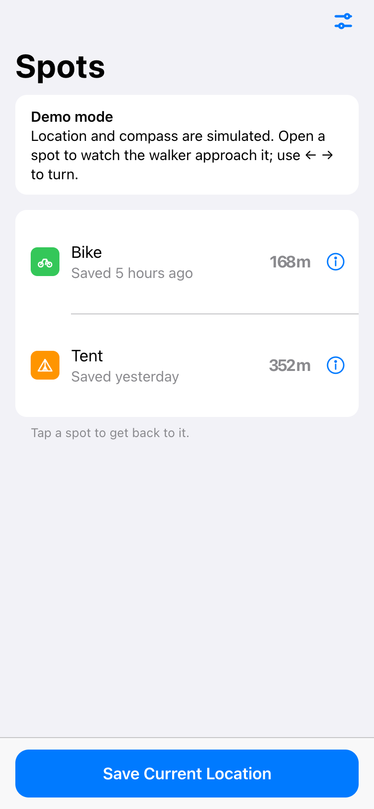
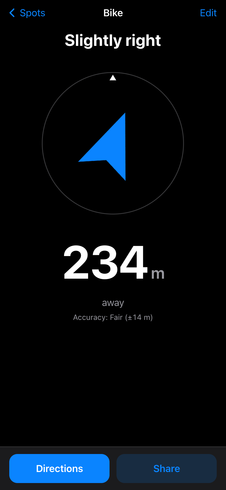
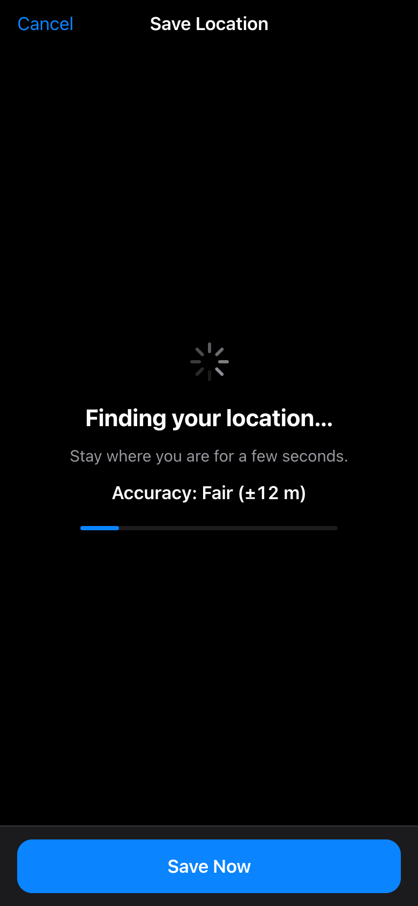
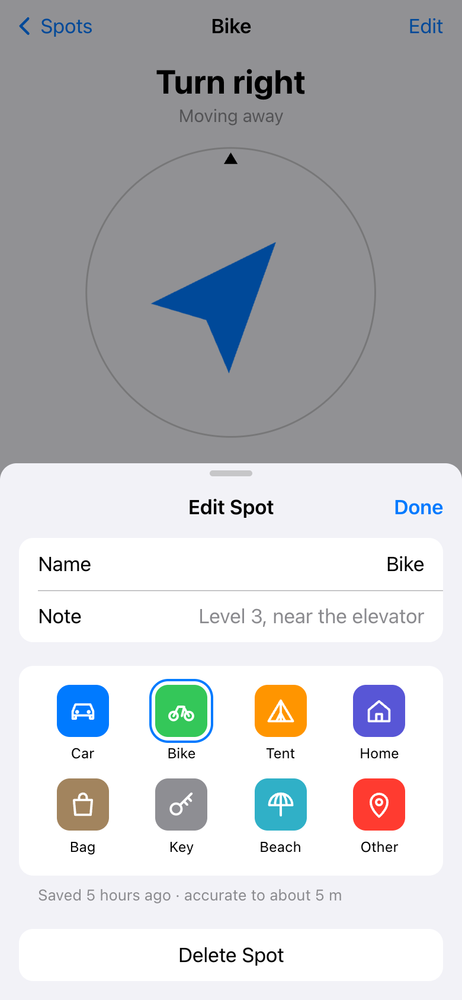

# Spotback

Save your current location — where you parked, your tent, your bag on the beach — and get guided back with a rotating arrow and live distance, like AirTag Precision Finding.

Plain native-iOS look · single `index.html` · vanilla JS · no libraries · no backend · installable PWA · works offline. Spots never leave your device.

<p align="center">
  
  
  
  
</p>

## Try it

- **Live:** deploy this folder to any static host (see below) and open it on your phone over HTTPS.
- **Desktop preview:** add `?demo=1` to the URL. GPS and compass are simulated — a "Car" spot is created, the fake walker approaches it when you open Directions, and ← / → turn you.

```sh
npx serve .     # http://localhost:3000/?demo=1
```

## Features

| | |
|---|---|
| **Save Current Location** | Collects high-accuracy GPS fixes for up to 9 s, auto-saves once accuracy is ≤ 5 m, otherwise keeps the best reading. "Save Now" is available after the first fix. |
| **Spots list** | Icon tile, name, "Saved 2 hours ago", live distance, ⓘ to edit. Empty state like Apple Notes. |
| **Edit sheet** | Name, note, 4×2 icon picker (Car, Bike, Tent, Home, Bag, Key, Beach, Other), delete with Undo. |
| **Directions** | 28 px instruction ("Straight ahead", "Slightly left", "Turn around"), "Getting closer / Moving away" trend, rotating arrow that turns green and pulses when you face the spot, 80 px distance, accuracy line. Opens Apple Maps / Google Maps walking directions for the long part. |
| **Arrival** | Within `max(6 m, min(0.8 × accuracy, 15 m))` for two fixes → "You're Here" card with Done / Delete Spot / Keep Looking. |
| **Share** | Web Share API with copy-link fallback; links carry `lat,lng,name` in the hash and open an Import sheet. |
| **Settings** | Meters / Feet, vibration, two-tap Delete All, privacy & install notes. |
| **Platform** | Dark mode, safe-area insets, reduced motion, 44 px targets, Back gesture closes the top sheet (one history entry per layer), wake lock while navigating, GPS paused when the tab is hidden. |

## Files

```
index.html             the whole app (inline CSS + JS)
manifest.webmanifest   PWA manifest
sw.js                  service worker: network-first pages, cached fallback for offline
icons/                 icon.svg + 180 / 192 / 512 PNG
vercel.json            cache headers (sw.js and index.html never cached)
docs/screenshots/      images used in this README
```

## Hosting

**Location only works over HTTPS** — browsers refuse to share GPS or the compass on plain `http://`. `localhost` counts as secure for local testing.

Push the folder to any static host — Vercel, Netlify, GitHub Pages, Cloudflare Pages. There is no build step: the root is the site.

- **Vercel:** *Add New → Project → Import* this repo, leave Framework = Other, deploy.
- **GitHub Pages:** *Settings → Pages → Deploy from branch → main / root*.

## Install to the home screen

- **iPhone / iPad (Safari):** Share → **Add to Home Screen**.
- **Android (Chrome):** menu ⋮ → **Install app** / **Add to Home screen**.
- **Desktop Chrome / Edge:** click the install icon in the address bar.

## How the compass works (and when it doesn't)

- Arrow angle = bearing from you to the spot (initial-bearing formula) − device heading, eased in `requestAnimationFrame` along the shortest path so it never spins the long way round.
- Heading sources, in order: iOS `webkitCompassHeading`; Android `deviceorientationabsolute` (flat: `360 − alpha`; upright: tilt-compensated); otherwise GPS course while walking faster than 0.8 m/s.
- The compass is treated as live only when a valid reading arrived in the last 2.5 s. The text under the dial always tells you the real state: live, needs permission (iOS "Turn On"), blocked, no compass (desktop → north-up), or walking-direction fallback.
- iOS asks for motion permission once per page load, so the "Turn On" step may appear again after a relaunch. If it was denied: Settings → Safari → **Motion & Orientation Access**.

## Known limits

- **GPS is about 3–10 m outdoors** and much worse indoors, in parking garages or between tall buildings. The arrow is for the last stretch and is hidden when you are closer than the GPS uncertainty ("You're very close, look around"). It is not centimetre-precise.
- **Phone compasses drift** near cars and metal. Wave the phone in a figure-8 to recalibrate.
- **No background tracking.** Location stops when the app is hidden and resumes when you return.
- **Vibration** works on Android browsers only; iOS Safari has no `navigator.vibrate`.
- **Storage is per browser.** Clearing site data deletes your spots. Use Share to move a spot to another device.

## Privacy

Everything is stored in `localStorage` on your device. No server, no accounts, no analytics, no network requests other than loading the app itself.
